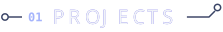
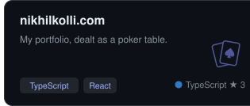
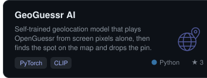
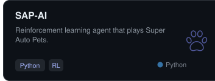
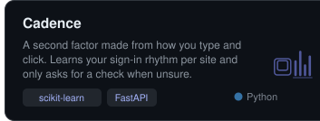
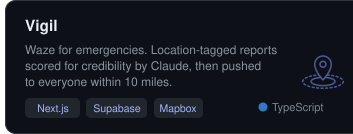
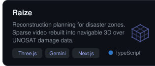

<a href="https://nikhilkolli.com"><picture><source media="(max-width: 539px), (min-width: 768px) and (max-width: 823px)" srcset="https://raw.githubusercontent.com/andrey-rublev/andrey-rublev/main/assets/hero-m.svg?v=43d36672" width="100%" /><source media="(prefers-color-scheme: dark)" srcset="https://raw.githubusercontent.com/andrey-rublev/andrey-rublev/main/assets/hero-dark.svg?v=ad1b2853" /><source media="(prefers-color-scheme: light)" srcset="https://raw.githubusercontent.com/andrey-rublev/andrey-rublev/main/assets/hero-light.svg?v=9dee02b3" /></picture></a>

<a href="https://nikhilkolli.com"><picture><source media="(prefers-color-scheme: dark)" srcset="https://raw.githubusercontent.com/andrey-rublev/andrey-rublev/main/assets/portfolio-dark.svg?v=8e0e5871" /><source media="(prefers-color-scheme: light)" srcset="https://raw.githubusercontent.com/andrey-rublev/andrey-rublev/main/assets/portfolio-light.svg?v=664ba4f7" /></picture></a> <a href="https://linkedin.com/in/nikhilxkolli"><picture><source media="(prefers-color-scheme: dark)" srcset="https://raw.githubusercontent.com/andrey-rublev/andrey-rublev/main/assets/linkedin-dark.svg?v=24e048d8" /><source media="(prefers-color-scheme: light)" srcset="https://raw.githubusercontent.com/andrey-rublev/andrey-rublev/main/assets/linkedin-light.svg?v=f9e9a27b" /></picture></a>

<!--
  The 1px image at the end of this line is the counter, not decoration.

  komarev has no API, only an SVG with the number baked in, and it dedupes by
  connecting IP. It never sees a visitor either way - GitHub's camo proxy fetches
  every README image - but camo is a large, rotating fleet, so a direct embed
  still arrives as many distinct addresses and keeps counting. Put the Worker in
  that path and the same views all arrive from the handful of Cloudflare egress
  addresses it exits from, get deduped, and the number stops moving. That is how
  this sat frozen at 2,869 looking perfectly healthy.

  So komarev stays embedded directly, and the Worker only reads the number back
  out of it to draw the pill - which is what makes the two badges match.
-->
<a href="#"><picture><source media="(prefers-color-scheme: dark)" srcset="https://nk-visits-badge.nikhilkolli1.workers.dev/github?theme=dark" /><source media="(prefers-color-scheme: light)" srcset="https://nk-visits-badge.nikhilkolli1.workers.dev/github?theme=light" /></picture></a> <a href="#"><picture><source media="(prefers-color-scheme: dark)" srcset="https://nk-visits-badge.nikhilkolli1.workers.dev/?theme=dark" /><source media="(prefers-color-scheme: light)" srcset="https://nk-visits-badge.nikhilkolli1.workers.dev/?theme=light" /></picture></a>

Computer engineer building ML systems — quantum-classical hybrids, autonomy stacks, RL agents, and apps people actually use.

<h2><picture><source media="(prefers-color-scheme: dark)" srcset="https://raw.githubusercontent.com/andrey-rublev/andrey-rublev/main/assets/section-projects-dark.svg?v=efc91f62" /><source media="(prefers-color-scheme: light)" srcset="https://raw.githubusercontent.com/andrey-rublev/andrey-rublev/main/assets/section-projects-light.svg?v=46c0bac2" /></picture></h2>

<picture><source media="(max-width: 539px), (min-width: 768px) and (max-width: 823px)" srcset="https://raw.githubusercontent.com/andrey-rublev/andrey-rublev/main/assets/cards/nikhilkolli-com-m.svg?v=630db994" width="71.47%" /><source media="(prefers-color-scheme: dark)" srcset="https://raw.githubusercontent.com/andrey-rublev/andrey-rublev/main/assets/cards/nikhilkolli-com-dark.svg?v=eacabe6d" /><source media="(prefers-color-scheme: light)" srcset="https://raw.githubusercontent.com/andrey-rublev/andrey-rublev/main/assets/cards/nikhilkolli-com-light.svg?v=37a001fb" /></picture><a href="https://nikhilkolli.com" title="nikhilkolli.com live site"><picture><source media="(max-width: 539px), (min-width: 768px) and (max-width: 823px)" srcset="https://raw.githubusercontent.com/andrey-rublev/andrey-rublev/main/assets/cards/nikhilkolli-com-site-m.svg?v=833ac084" width="11.17%" /><source media="(prefers-color-scheme: dark)" srcset="https://raw.githubusercontent.com/andrey-rublev/andrey-rublev/main/assets/cards/nikhilkolli-com-site-dark.svg?v=00da7f7c" /><source media="(prefers-color-scheme: light)" srcset="https://raw.githubusercontent.com/andrey-rublev/andrey-rublev/main/assets/cards/nikhilkolli-com-site-light.svg?v=59213b2e" /></picture></a><a href="https://github.com/andrey-rublev/NK-Portfolio-Poker" title="nikhilkolli.com repository"><picture><source media="(max-width: 539px), (min-width: 768px) and (max-width: 823px)" srcset="https://raw.githubusercontent.com/andrey-rublev/andrey-rublev/main/assets/cards/nikhilkolli-com-repo-m.svg?v=c47cd185" width="17.35%" /><source media="(prefers-color-scheme: dark)" srcset="https://raw.githubusercontent.com/andrey-rublev/andrey-rublev/main/assets/cards/nikhilkolli-com-repo-dark.svg?v=03911cab" /><source media="(prefers-color-scheme: light)" srcset="https://raw.githubusercontent.com/andrey-rublev/andrey-rublev/main/assets/cards/nikhilkolli-com-repo-light.svg?v=6a9c6ce5" /></picture></a><picture><source media="(max-width: 539px), (min-width: 768px) and (max-width: 823px)" srcset="https://raw.githubusercontent.com/andrey-rublev/andrey-rublev/main/assets/cards/geoguessr-ai-m.svg?v=a162f4b7" width="82.64%" /><source media="(prefers-color-scheme: dark)" srcset="https://raw.githubusercontent.com/andrey-rublev/andrey-rublev/main/assets/cards/geoguessr-ai-dark.svg?v=0b7b5b1c" /><source media="(prefers-color-scheme: light)" srcset="https://raw.githubusercontent.com/andrey-rublev/andrey-rublev/main/assets/cards/geoguessr-ai-light.svg?v=473f0144" /></picture><a href="https://github.com/andrey-rublev/geoguessr-AI" title="GeoGuessr AI repository"><picture><source media="(max-width: 539px), (min-width: 768px) and (max-width: 823px)" srcset="https://raw.githubusercontent.com/andrey-rublev/andrey-rublev/main/assets/cards/geoguessr-ai-repo-m.svg?v=6d1554d7" width="17.35%" /><source media="(prefers-color-scheme: dark)" srcset="https://raw.githubusercontent.com/andrey-rublev/andrey-rublev/main/assets/cards/geoguessr-ai-repo-dark.svg?v=2980cbb0" /><source media="(prefers-color-scheme: light)" srcset="https://raw.githubusercontent.com/andrey-rublev/andrey-rublev/main/assets/cards/geoguessr-ai-repo-light.svg?v=dbd3d890" /></picture></a>

<picture><source media="(max-width: 539px), (min-width: 768px) and (max-width: 823px)" srcset="https://raw.githubusercontent.com/andrey-rublev/andrey-rublev/main/assets/cards/sap-ai-m.svg?v=88cf886c" width="82.64%" /><source media="(prefers-color-scheme: dark)" srcset="https://raw.githubusercontent.com/andrey-rublev/andrey-rublev/main/assets/cards/sap-ai-dark.svg?v=671df065" /><source media="(prefers-color-scheme: light)" srcset="https://raw.githubusercontent.com/andrey-rublev/andrey-rublev/main/assets/cards/sap-ai-light.svg?v=db4f4e88" /></picture><a href="https://github.com/andrey-rublev/SAP-AI" title="SAP-AI repository"><picture><source media="(max-width: 539px), (min-width: 768px) and (max-width: 823px)" srcset="https://raw.githubusercontent.com/andrey-rublev/andrey-rublev/main/assets/cards/sap-ai-repo-m.svg?v=13429a64" width="17.35%" /><source media="(prefers-color-scheme: dark)" srcset="https://raw.githubusercontent.com/andrey-rublev/andrey-rublev/main/assets/cards/sap-ai-repo-dark.svg?v=e22858b0" /><source media="(prefers-color-scheme: light)" srcset="https://raw.githubusercontent.com/andrey-rublev/andrey-rublev/main/assets/cards/sap-ai-repo-light.svg?v=9f1ae5c4" /></picture></a><picture><source media="(max-width: 539px), (min-width: 768px) and (max-width: 823px)" srcset="https://raw.githubusercontent.com/andrey-rublev/andrey-rublev/main/assets/cards/cadence-m.svg?v=8478c104" width="82.64%" /><source media="(prefers-color-scheme: dark)" srcset="https://raw.githubusercontent.com/andrey-rublev/andrey-rublev/main/assets/cards/cadence-dark.svg?v=96e885c8" /><source media="(prefers-color-scheme: light)" srcset="https://raw.githubusercontent.com/andrey-rublev/andrey-rublev/main/assets/cards/cadence-light.svg?v=d98b0dd0" /></picture><a href="https://github.com/andrey-rublev/cadence" title="Cadence repository"><picture><source media="(max-width: 539px), (min-width: 768px) and (max-width: 823px)" srcset="https://raw.githubusercontent.com/andrey-rublev/andrey-rublev/main/assets/cards/cadence-repo-m.svg?v=9b32bfd6" width="17.35%" /><source media="(prefers-color-scheme: dark)" srcset="https://raw.githubusercontent.com/andrey-rublev/andrey-rublev/main/assets/cards/cadence-repo-dark.svg?v=d3336ab5" /><source media="(prefers-color-scheme: light)" srcset="https://raw.githubusercontent.com/andrey-rublev/andrey-rublev/main/assets/cards/cadence-repo-light.svg?v=98251ec5" /></picture></a>

<picture><source media="(max-width: 539px), (min-width: 768px) and (max-width: 823px)" srcset="https://raw.githubusercontent.com/andrey-rublev/andrey-rublev/main/assets/cards/vigil-m.svg?v=4d377022" width="82.64%" /><source media="(prefers-color-scheme: dark)" srcset="https://raw.githubusercontent.com/andrey-rublev/andrey-rublev/main/assets/cards/vigil-dark.svg?v=fae01832" /><source media="(prefers-color-scheme: light)" srcset="https://raw.githubusercontent.com/andrey-rublev/andrey-rublev/main/assets/cards/vigil-light.svg?v=c7fcf5c0" /></picture><a href="https://github.com/seno3/vigil" title="Vigil repository"><picture><source media="(max-width: 539px), (min-width: 768px) and (max-width: 823px)" srcset="https://raw.githubusercontent.com/andrey-rublev/andrey-rublev/main/assets/cards/vigil-repo-m.svg?v=60d7560c" width="17.35%" /><source media="(prefers-color-scheme: dark)" srcset="https://raw.githubusercontent.com/andrey-rublev/andrey-rublev/main/assets/cards/vigil-repo-dark.svg?v=c702be78" /><source media="(prefers-color-scheme: light)" srcset="https://raw.githubusercontent.com/andrey-rublev/andrey-rublev/main/assets/cards/vigil-repo-light.svg?v=16d3ddc9" /></picture></a><picture><source media="(max-width: 539px), (min-width: 768px) and (max-width: 823px)" srcset="https://raw.githubusercontent.com/andrey-rublev/andrey-rublev/main/assets/cards/raize-m.svg?v=7c4efcef" width="71.47%" /><source media="(prefers-color-scheme: dark)" srcset="https://raw.githubusercontent.com/andrey-rublev/andrey-rublev/main/assets/cards/raize-dark.svg?v=576284f7" /><source media="(prefers-color-scheme: light)" srcset="https://raw.githubusercontent.com/andrey-rublev/andrey-rublev/main/assets/cards/raize-light.svg?v=916363bf" /></picture><a href="https://raize-psi.vercel.app" title="Raize live site"><picture><source media="(max-width: 539px), (min-width: 768px) and (max-width: 823px)" srcset="https://raw.githubusercontent.com/andrey-rublev/andrey-rublev/main/assets/cards/raize-site-m.svg?v=54171b16" width="11.17%" /><source media="(prefers-color-scheme: dark)" srcset="https://raw.githubusercontent.com/andrey-rublev/andrey-rublev/main/assets/cards/raize-site-dark.svg?v=8f35f29c" /><source media="(prefers-color-scheme: light)" srcset="https://raw.githubusercontent.com/andrey-rublev/andrey-rublev/main/assets/cards/raize-site-light.svg?v=50c7fc13" /></picture></a><a href="https://github.com/JuliusZhou124/raize" title="Raize repository"><picture><source media="(max-width: 539px), (min-width: 768px) and (max-width: 823px)" srcset="https://raw.githubusercontent.com/andrey-rublev/andrey-rublev/main/assets/cards/raize-repo-m.svg?v=f1ba36f9" width="17.35%" /><source media="(prefers-color-scheme: dark)" srcset="https://raw.githubusercontent.com/andrey-rublev/andrey-rublev/main/assets/cards/raize-repo-dark.svg?v=d11b03e4" /><source media="(prefers-color-scheme: light)" srcset="https://raw.githubusercontent.com/andrey-rublev/andrey-rublev/main/assets/cards/raize-repo-light.svg?v=2304bd93" /></picture></a>

<picture><source media="(max-width: 539px), (min-width: 768px) and (max-width: 823px)" srcset="https://raw.githubusercontent.com/andrey-rublev/andrey-rublev/main/assets/stack-m.svg?v=7075b7d2" width="340" /><source media="(prefers-color-scheme: dark)" srcset="https://raw.githubusercontent.com/andrey-rublev/andrey-rublev/main/assets/stack-dark.svg?v=0576eea8" /><source media="(prefers-color-scheme: light)" srcset="https://raw.githubusercontent.com/andrey-rublev/andrey-rublev/main/assets/stack-light.svg?v=a7c830b5" /></picture>

<h2><picture><source media="(prefers-color-scheme: dark)" srcset="https://raw.githubusercontent.com/andrey-rublev/andrey-rublev/main/assets/section-contributions-dark.svg?v=0b8f333a" /><source media="(prefers-color-scheme: light)" srcset="https://raw.githubusercontent.com/andrey-rublev/andrey-rublev/main/assets/section-contributions-light.svg?v=11c4ad9f" /></picture></h2>

<picture><source media="(max-width: 539px), (min-width: 768px) and (max-width: 823px)" srcset="https://raw.githubusercontent.com/andrey-rublev/andrey-rublev/main/assets/contrib-m.svg?v=e3930d2a" width="100%" /><source media="(prefers-color-scheme: dark)" srcset="https://raw.githubusercontent.com/andrey-rublev/andrey-rublev/main/assets/contrib-dark.svg?v=aadbb7d8" /><source media="(prefers-color-scheme: light)" srcset="https://raw.githubusercontent.com/andrey-rublev/andrey-rublev/main/assets/contrib-light.svg?v=b2be7a5e" /></picture>

