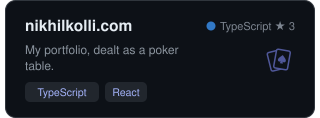
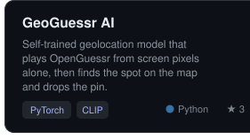
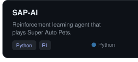
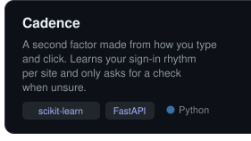
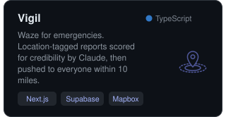
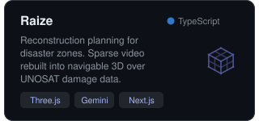

<!-- GitHub replaces each color-scheme query when an account theme is selected. Keep it on its own source so viewport and motion preferences still reach the browser.
     Line breaks stay inside the picture tags so the inactive image cannot wrap onto a blank line. -->
<h1 align="center"><a href="assets/v5/performance.md" title="Open the deck close-up"><picture
  ><source media="(prefers-color-scheme: dark)" srcset="https://raw.githubusercontent.com/andrey-rublev/andrey-rublev/main/assets/cards/none.svg?v=42c26dbb" width="0" height="0"
  ><source media="(prefers-reduced-motion: reduce) and (max-width: 519.98px), (prefers-reduced-motion: reduce) and (min-width: 768px) and (max-width: 801.98px)" srcset="assets/v5/mobile-still.webp?v=78d548ec" width="360"
  ><source media="(max-width: 519.98px), (min-width: 768px) and (max-width: 801.98px)" type="image/avif" srcset="assets/v5/mobile.avif?v=59336a14" width="360"
  ><source media="(max-width: 519.98px), (min-width: 768px) and (max-width: 801.98px)" srcset="assets/v5/mobile.webp?v=b4db9a29" width="360"
  ><source media="(prefers-reduced-motion: reduce) and (max-width: 709.98px), (prefers-reduced-motion: reduce) and (min-width: 768px) and (max-width: 1059.98px)" srcset="assets/v5/mid-still.webp?v=48e0808d" width="560"
  ><source media="(max-width: 709.98px), (min-width: 768px) and (max-width: 1059.98px)" type="image/avif" srcset="assets/v5/mid.avif?v=ed211fe2" width="560"
  ><source media="(max-width: 709.98px), (min-width: 768px) and (max-width: 1059.98px)" srcset="assets/v5/mid.webp?v=0fea12d0" width="560"
  ><source media="(prefers-reduced-motion: reduce)" srcset="assets/v5/wide-still.webp?v=77b68fb3" width="846"
  ><source type="image/avif" srcset="assets/v5/wide.avif?v=5355dc5c" width="846"
  ></picture><picture
  ><source media="(prefers-color-scheme: light)" srcset="https://raw.githubusercontent.com/andrey-rublev/andrey-rublev/main/assets/cards/none.svg?v=42c26dbb" width="0" height="0"
  ><source media="(prefers-reduced-motion: reduce) and (max-width: 519.98px), (prefers-reduced-motion: reduce) and (min-width: 768px) and (max-width: 801.98px)" srcset="assets/v5/mobile-dark-still.webp?v=df2eb733" width="360"
  ><source media="(max-width: 519.98px), (min-width: 768px) and (max-width: 801.98px)" type="image/avif" srcset="assets/v5/mobile-dark.avif?v=b7872c33" width="360"
  ><source media="(max-width: 519.98px), (min-width: 768px) and (max-width: 801.98px)" srcset="assets/v5/mobile-dark.webp?v=31c046d0" width="360"
  ><source media="(prefers-reduced-motion: reduce) and (max-width: 709.98px), (prefers-reduced-motion: reduce) and (min-width: 768px) and (max-width: 1059.98px)" srcset="assets/v5/mid-dark-still.webp?v=53373218" width="560"
  ><source media="(max-width: 709.98px), (min-width: 768px) and (max-width: 1059.98px)" type="image/avif" srcset="assets/v5/mid-dark.avif?v=550e5136" width="560"
  ><source media="(max-width: 709.98px), (min-width: 768px) and (max-width: 1059.98px)" srcset="assets/v5/mid-dark.webp?v=5e026fac" width="560"
  ><source media="(prefers-reduced-motion: reduce)" srcset="assets/v5/wide-dark-still.webp?v=fdbf54f4" width="846"
  ><source type="image/avif" srcset="assets/v5/wide-dark.avif?v=a8d8f7c8" width="846"
  ><source srcset="assets/v5/wide-dark.webp?v=607bfe5b" width="846"
  ></picture></a></h1>

<a href="https://nikhilkolli.com"><picture><source media="(prefers-color-scheme: dark)" srcset="https://raw.githubusercontent.com/andrey-rublev/andrey-rublev/main/assets/portfolio-dark.svg?v=8e0e5871" /><source media="(prefers-color-scheme: light)" srcset="https://raw.githubusercontent.com/andrey-rublev/andrey-rublev/main/assets/portfolio-light.svg?v=664ba4f7" /></picture></a> <a href="https://linkedin.com/in/nikhilxkolli"><picture><source media="(prefers-color-scheme: dark)" srcset="https://raw.githubusercontent.com/andrey-rublev/andrey-rublev/main/assets/linkedin-dark.svg?v=24e048d8" /><source media="(prefers-color-scheme: light)" srcset="https://raw.githubusercontent.com/andrey-rublev/andrey-rublev/main/assets/linkedin-light.svg?v=f9e9a27b" /></picture></a>

<!--
  The 1px image at the end of this line is the counter, not decoration.

  komarev has no API, only an SVG with the number baked in, and it dedupes by
  connecting IP. It never sees a visitor either way - GitHub's camo proxy fetches
  every README image - but camo is a large, rotating fleet, so a direct embed
  still arrives as many distinct addresses and keeps counting. Put the Worker in
  that path and the same views all arrive from the handful of Cloudflare egress
  addresses it exits from, get deduped, and the number stops moving. That is how
  this sat frozen at 2,869 looking perfectly healthy.

  So komarev stays embedded directly, and the Worker only reads the number back
  out of it to draw the pill - which is what makes the two badges match.
-->
<a href="#"><picture><source media="(prefers-color-scheme: dark)" srcset="https://nk-visits-badge.nikhilkolli1.workers.dev/github?theme=dark" /><source media="(prefers-color-scheme: light)" srcset="https://nk-visits-badge.nikhilkolli1.workers.dev/github?theme=light" /></picture></a> <a href="#"><picture><source media="(prefers-color-scheme: dark)" srcset="https://nk-visits-badge.nikhilkolli1.workers.dev/?theme=dark" /><source media="(prefers-color-scheme: light)" srcset="https://nk-visits-badge.nikhilkolli1.workers.dev/?theme=light" /></picture></a>

Computer engineer building ML systems — quantum-classical hybrids, autonomy stacks, RL agents, and apps people actually use.

<h2><picture><source media="(prefers-color-scheme: dark)" srcset="https://raw.githubusercontent.com/andrey-rublev/andrey-rublev/main/assets/section-projects-dark.svg?v=efc91f62" /><source media="(prefers-color-scheme: light)" srcset="https://raw.githubusercontent.com/andrey-rublev/andrey-rublev/main/assets/section-projects-light.svg?v=46c0bac2" /></picture></h2>

<picture><source media="(max-width: 539.98px), (min-width: 768px) and (max-width: 823.98px)" srcset="https://raw.githubusercontent.com/andrey-rublev/andrey-rublev/main/assets/cards/none.svg?v=42c26dbb" width="0" /><source media="(min-width: 540px) and (max-width: 767.98px), (min-width: 824px) and (max-width: 1239.98px)" srcset="https://raw.githubusercontent.com/andrey-rublev/andrey-rublev/main/assets/cards/nikhilkolli-com-t-a.svg?v=3a82b8d6" width="315" /><source media="(prefers-color-scheme: dark)" srcset="https://raw.githubusercontent.com/andrey-rublev/andrey-rublev/main/assets/cards/nikhilkolli-com-t-dark.svg?v=09f2cef7" width="38.15%" /><source media="(prefers-color-scheme: light)" srcset="https://raw.githubusercontent.com/andrey-rublev/andrey-rublev/main/assets/cards/nikhilkolli-com-t-light.svg?v=54fae1b6" width="38.15%" /></picture><a href="https://nikhilkolli.com" title="nikhilkolli.com live site"><picture><source media="(max-width: 539.98px), (min-width: 768px) and (max-width: 823.98px)" srcset="https://raw.githubusercontent.com/andrey-rublev/andrey-rublev/main/assets/cards/none.svg?v=42c26dbb" width="0" /><source media="(min-width: 540px) and (max-width: 767.98px), (min-width: 824px) and (max-width: 1239.98px)" srcset="https://raw.githubusercontent.com/andrey-rublev/andrey-rublev/main/assets/cards/nikhilkolli-com-site-btn-a.svg?v=e221a12e" width="38" /><source media="(prefers-color-scheme: dark)" srcset="https://raw.githubusercontent.com/andrey-rublev/andrey-rublev/main/assets/cards/nikhilkolli-com-site-btn-dark.svg?v=664304a5" width="4.6%" /><source media="(prefers-color-scheme: light)" srcset="https://raw.githubusercontent.com/andrey-rublev/andrey-rublev/main/assets/cards/nikhilkolli-com-site-btn-light.svg?v=98bdc1a6" width="4.6%" /></picture></a><a href="https://github.com/andrey-rublev/NK-Portfolio-Poker" title="nikhilkolli.com repository"><picture><source media="(max-width: 539.98px), (min-width: 768px) and (max-width: 823.98px)" srcset="https://raw.githubusercontent.com/andrey-rublev/andrey-rublev/main/assets/cards/none.svg?v=42c26dbb" width="0" /><source media="(min-width: 540px) and (max-width: 767.98px), (min-width: 824px) and (max-width: 1239.98px)" srcset="https://raw.githubusercontent.com/andrey-rublev/andrey-rublev/main/assets/cards/nikhilkolli-com-repo-btn-a.svg?v=918403e0" width="38" /><source media="(prefers-color-scheme: dark)" srcset="https://raw.githubusercontent.com/andrey-rublev/andrey-rublev/main/assets/cards/nikhilkolli-com-repo-btn-dark.svg?v=872c8b61" width="4.6%" /><source media="(prefers-color-scheme: light)" srcset="https://raw.githubusercontent.com/andrey-rublev/andrey-rublev/main/assets/cards/nikhilkolli-com-repo-btn-light.svg?v=fe04b7b3" width="4.6%" /></picture></a><picture><source media="(max-width: 539.98px), (min-width: 768px) and (max-width: 823.98px)" srcset="https://raw.githubusercontent.com/andrey-rublev/andrey-rublev/main/assets/cards/none.svg?v=42c26dbb" width="0" /><source media="(min-width: 540px) and (max-width: 767.98px), (min-width: 824px) and (max-width: 1239.98px)" srcset="https://raw.githubusercontent.com/andrey-rublev/andrey-rublev/main/assets/cards/nikhilkolli-com-tr-a.svg?v=8505e214" width="21" /><source media="(prefers-color-scheme: dark)" srcset="https://raw.githubusercontent.com/andrey-rublev/andrey-rublev/main/assets/cards/nikhilkolli-com-tr-dark.svg?v=417c6e43" width="2.54%" /><source media="(prefers-color-scheme: light)" srcset="https://raw.githubusercontent.com/andrey-rublev/andrey-rublev/main/assets/cards/nikhilkolli-com-tr-light.svg?v=c5f83a8f" width="2.54%" /></picture><picture><source media="(max-width: 1239.98px)" srcset="https://raw.githubusercontent.com/andrey-rublev/andrey-rublev/main/assets/cards/none.svg?v=42c26dbb" width="0" /><source media="(prefers-color-scheme: dark)" srcset="https://raw.githubusercontent.com/andrey-rublev/andrey-rublev/main/assets/cards/geoguessr-ai-t-dark.svg?v=156e55d3" width="42.75%" /><source media="(prefers-color-scheme: light)" srcset="https://raw.githubusercontent.com/andrey-rublev/andrey-rublev/main/assets/cards/geoguessr-ai-t-light.svg?v=40eca38b" width="42.75%" /></picture><a href="https://github.com/andrey-rublev/geoguessr-AI" title="GeoGuessr AI repository"><picture><source media="(max-width: 1239.98px)" srcset="https://raw.githubusercontent.com/andrey-rublev/andrey-rublev/main/assets/cards/none.svg?v=42c26dbb" width="0" /><source media="(prefers-color-scheme: dark)" srcset="https://raw.githubusercontent.com/andrey-rublev/andrey-rublev/main/assets/cards/geoguessr-ai-repo-btn-dark.svg?v=d7091bb9" width="4.6%" /><source media="(prefers-color-scheme: light)" srcset="https://raw.githubusercontent.com/andrey-rublev/andrey-rublev/main/assets/cards/geoguessr-ai-repo-btn-light.svg?v=8fecf8be" width="4.6%" /></picture></a><picture><source media="(max-width: 1239.98px)" srcset="https://raw.githubusercontent.com/andrey-rublev/andrey-rublev/main/assets/cards/none.svg?v=42c26dbb" width="0" /><source media="(prefers-color-scheme: dark)" srcset="https://raw.githubusercontent.com/andrey-rublev/andrey-rublev/main/assets/cards/geoguessr-ai-tr-dark.svg?v=a6d7d923" width="2.54%" /><source media="(prefers-color-scheme: light)" srcset="https://raw.githubusercontent.com/andrey-rublev/andrey-rublev/main/assets/cards/geoguessr-ai-tr-light.svg?v=25475e1c" width="2.54%" /></picture><picture><source media="(max-width: 539.98px), (min-width: 768px) and (max-width: 823.98px)" srcset="https://raw.githubusercontent.com/andrey-rublev/andrey-rublev/main/assets/cards/none.svg?v=42c26dbb" width="0" /><source media="(min-width: 540px) and (max-width: 767.98px), (min-width: 824px) and (max-width: 1239.98px)" srcset="https://raw.githubusercontent.com/andrey-rublev/andrey-rublev/main/assets/cards/nikhilkolli-com-b-a.svg?v=88e292b0" width="412" /><source media="(prefers-color-scheme: dark)" srcset="https://raw.githubusercontent.com/andrey-rublev/andrey-rublev/main/assets/cards/nikhilkolli-com-b-dark.svg?v=7a2c0f64" width="49.9%" /><source media="(prefers-color-scheme: light)" srcset="https://raw.githubusercontent.com/andrey-rublev/andrey-rublev/main/assets/cards/nikhilkolli-com-b-light.svg?v=f68c8443" width="49.9%" /></picture><picture><source media="(min-width: 540px) and (max-width: 767.98px), (min-width: 824px)" srcset="https://raw.githubusercontent.com/andrey-rublev/andrey-rublev/main/assets/cards/none.svg?v=42c26dbb" width="0" /><source media="(prefers-color-scheme: dark)" srcset="https://raw.githubusercontent.com/andrey-rublev/andrey-rublev/main/assets/cards/nikhilkolli-com-m-dark.svg?v=c5c05b6c" width="100%" /><source media="(prefers-color-scheme: light)" srcset="https://raw.githubusercontent.com/andrey-rublev/andrey-rublev/main/assets/cards/nikhilkolli-com-m-light.svg?v=81e73c66" width="100%" /></picture><a href="https://nikhilkolli.com" title="nikhilkolli.com live site"><picture><source media="(min-width: 540px) and (max-width: 767.98px), (min-width: 824px)" srcset="https://raw.githubusercontent.com/andrey-rublev/andrey-rublev/main/assets/cards/none.svg?v=42c26dbb" width="0" /><source media="(prefers-color-scheme: dark)" srcset="https://raw.githubusercontent.com/andrey-rublev/andrey-rublev/main/assets/cards/nikhilkolli-com-site-pill-dark.svg?v=bc4e0eec" width="32.5%" /><source media="(prefers-color-scheme: light)" srcset="https://raw.githubusercontent.com/andrey-rublev/andrey-rublev/main/assets/cards/nikhilkolli-com-site-pill-light.svg?v=90eb7954" width="32.5%" /></picture></a><a href="https://github.com/andrey-rublev/NK-Portfolio-Poker" title="nikhilkolli.com repository"><picture><source media="(min-width: 540px) and (max-width: 767.98px), (min-width: 824px)" srcset="https://raw.githubusercontent.com/andrey-rublev/andrey-rublev/main/assets/cards/none.svg?v=42c26dbb" width="0" /><source media="(prefers-color-scheme: dark)" srcset="https://raw.githubusercontent.com/andrey-rublev/andrey-rublev/main/assets/cards/nikhilkolli-com-repo-pill-dark.svg?v=a43709f1" width="28.74%" /><source media="(prefers-color-scheme: light)" srcset="https://raw.githubusercontent.com/andrey-rublev/andrey-rublev/main/assets/cards/nikhilkolli-com-repo-pill-light.svg?v=03229aeb" width="28.74%" /></picture></a><picture><source media="(min-width: 1240px)" srcset="https://raw.githubusercontent.com/andrey-rublev/andrey-rublev/main/assets/cards/none.svg?v=42c26dbb" width="0" /></picture><picture><source media="(max-width: 539.98px), (min-width: 768px) and (max-width: 823.98px)" srcset="https://raw.githubusercontent.com/andrey-rublev/andrey-rublev/main/assets/cards/none.svg?v=42c26dbb" width="0" /><source media="(min-width: 540px) and (max-width: 767.98px), (min-width: 824px) and (max-width: 1239.98px)" srcset="https://raw.githubusercontent.com/andrey-rublev/andrey-rublev/main/assets/cards/geoguessr-ai-t-a.svg?v=eda7b434" width="353" /><source media="(min-width: 1240px)" srcset="https://raw.githubusercontent.com/andrey-rublev/andrey-rublev/main/assets/cards/none.svg?v=42c26dbb" width="0" /></picture><a href="https://github.com/andrey-rublev/geoguessr-AI" title="GeoGuessr AI repository"><picture><source media="(max-width: 539.98px), (min-width: 768px) and (max-width: 823.98px)" srcset="https://raw.githubusercontent.com/andrey-rublev/andrey-rublev/main/assets/cards/none.svg?v=42c26dbb" width="0" /><source media="(min-width: 540px) and (max-width: 767.98px), (min-width: 824px) and (max-width: 1239.98px)" srcset="https://raw.githubusercontent.com/andrey-rublev/andrey-rublev/main/assets/cards/geoguessr-ai-repo-btn-a.svg?v=0ea2bdf0" width="38" /><source media="(min-width: 1240px)" srcset="https://raw.githubusercontent.com/andrey-rublev/andrey-rublev/main/assets/cards/none.svg?v=42c26dbb" width="0" /></picture></a><picture><source media="(max-width: 539.98px), (min-width: 768px) and (max-width: 823.98px)" srcset="https://raw.githubusercontent.com/andrey-rublev/andrey-rublev/main/assets/cards/none.svg?v=42c26dbb" width="0" /><source media="(min-width: 540px) and (max-width: 767.98px), (min-width: 824px) and (max-width: 1239.98px)" srcset="https://raw.githubusercontent.com/andrey-rublev/andrey-rublev/main/assets/cards/geoguessr-ai-tr-a.svg?v=3a40a0be" width="21" /><source media="(min-width: 1240px)" srcset="https://raw.githubusercontent.com/andrey-rublev/andrey-rublev/main/assets/cards/none.svg?v=42c26dbb" width="0" /></picture><picture><source media="(max-width: 539.98px), (min-width: 768px) and (max-width: 823.98px)" srcset="https://raw.githubusercontent.com/andrey-rublev/andrey-rublev/main/assets/cards/none.svg?v=42c26dbb" width="0" /><source media="(min-width: 540px) and (max-width: 767.98px), (min-width: 824px) and (max-width: 1239.98px)" srcset="https://raw.githubusercontent.com/andrey-rublev/andrey-rublev/main/assets/cards/geoguessr-ai-b-a.svg?v=2a038d4a" width="412" /><source media="(prefers-color-scheme: dark)" srcset="https://raw.githubusercontent.com/andrey-rublev/andrey-rublev/main/assets/cards/geoguessr-ai-b-dark.svg?v=57233361" width="49.9%" /><source media="(prefers-color-scheme: light)" srcset="https://raw.githubusercontent.com/andrey-rublev/andrey-rublev/main/assets/cards/geoguessr-ai-b-light.svg?v=f56f6aad" width="49.9%" /></picture><picture><source media="(min-width: 540px) and (max-width: 767.98px), (min-width: 824px)" srcset="https://raw.githubusercontent.com/andrey-rublev/andrey-rublev/main/assets/cards/none.svg?v=42c26dbb" width="0" /><source media="(prefers-color-scheme: dark)" srcset="https://raw.githubusercontent.com/andrey-rublev/andrey-rublev/main/assets/cards/geoguessr-ai-m-dark.svg?v=ef6a6f4e" width="100%" /><source media="(prefers-color-scheme: light)" srcset="https://raw.githubusercontent.com/andrey-rublev/andrey-rublev/main/assets/cards/geoguessr-ai-m-light.svg?v=222467b7" width="100%" /></picture><a href="https://github.com/andrey-rublev/geoguessr-AI" title="GeoGuessr AI repository"><picture><source media="(min-width: 540px) and (max-width: 767.98px), (min-width: 824px)" srcset="https://raw.githubusercontent.com/andrey-rublev/andrey-rublev/main/assets/cards/none.svg?v=42c26dbb" width="0" /><source media="(prefers-color-scheme: dark)" srcset="https://raw.githubusercontent.com/andrey-rublev/andrey-rublev/main/assets/cards/geoguessr-ai-repo-pill-dark.svg?v=71911b33" width="28.74%" /><source media="(prefers-color-scheme: light)" srcset="https://raw.githubusercontent.com/andrey-rublev/andrey-rublev/main/assets/cards/geoguessr-ai-repo-pill-light.svg?v=8f9dabc9" width="28.74%" /></picture></a><picture></picture><picture><source media="(max-width: 539.98px), (min-width: 768px) and (max-width: 823.98px)" srcset="https://raw.githubusercontent.com/andrey-rublev/andrey-rublev/main/assets/cards/none.svg?v=42c26dbb" width="0" /><source media="(min-width: 540px) and (max-width: 767.98px), (min-width: 824px) and (max-width: 1239.98px)" srcset="https://raw.githubusercontent.com/andrey-rublev/andrey-rublev/main/assets/cards/sap-ai-t-a.svg?v=67945103" width="353" /><source media="(prefers-color-scheme: dark)" srcset="https://raw.githubusercontent.com/andrey-rublev/andrey-rublev/main/assets/cards/sap-ai-t-dark.svg?v=985de64d" width="42.75%" /><source media="(prefers-color-scheme: light)" srcset="https://raw.githubusercontent.com/andrey-rublev/andrey-rublev/main/assets/cards/sap-ai-t-light.svg?v=f666419a" width="42.75%" /></picture><a href="https://github.com/andrey-rublev/SAP-AI" title="SAP-AI repository"><picture><source media="(max-width: 539.98px), (min-width: 768px) and (max-width: 823.98px)" srcset="https://raw.githubusercontent.com/andrey-rublev/andrey-rublev/main/assets/cards/none.svg?v=42c26dbb" width="0" /><source media="(min-width: 540px) and (max-width: 767.98px), (min-width: 824px) and (max-width: 1239.98px)" srcset="https://raw.githubusercontent.com/andrey-rublev/andrey-rublev/main/assets/cards/sap-ai-repo-btn-a.svg?v=ab73e633" width="38" /><source media="(prefers-color-scheme: dark)" srcset="https://raw.githubusercontent.com/andrey-rublev/andrey-rublev/main/assets/cards/sap-ai-repo-btn-dark.svg?v=5482a6a7" width="4.6%" /><source media="(prefers-color-scheme: light)" srcset="https://raw.githubusercontent.com/andrey-rublev/andrey-rublev/main/assets/cards/sap-ai-repo-btn-light.svg?v=1d145695" width="4.6%" /></picture></a><picture><source media="(max-width: 539.98px), (min-width: 768px) and (max-width: 823.98px)" srcset="https://raw.githubusercontent.com/andrey-rublev/andrey-rublev/main/assets/cards/none.svg?v=42c26dbb" width="0" /><source media="(min-width: 540px) and (max-width: 767.98px), (min-width: 824px) and (max-width: 1239.98px)" srcset="https://raw.githubusercontent.com/andrey-rublev/andrey-rublev/main/assets/cards/sap-ai-tr-a.svg?v=0a97e6a8" width="21" /><source media="(prefers-color-scheme: dark)" srcset="https://raw.githubusercontent.com/andrey-rublev/andrey-rublev/main/assets/cards/sap-ai-tr-dark.svg?v=ff872788" width="2.54%" /><source media="(prefers-color-scheme: light)" srcset="https://raw.githubusercontent.com/andrey-rublev/andrey-rublev/main/assets/cards/sap-ai-tr-light.svg?v=618da5c8" width="2.54%" /></picture><picture><source media="(max-width: 1239.98px)" srcset="https://raw.githubusercontent.com/andrey-rublev/andrey-rublev/main/assets/cards/none.svg?v=42c26dbb" width="0" /><source media="(prefers-color-scheme: dark)" srcset="https://raw.githubusercontent.com/andrey-rublev/andrey-rublev/main/assets/cards/cadence-t-dark.svg?v=60824dd3" width="42.75%" /><source media="(prefers-color-scheme: light)" srcset="https://raw.githubusercontent.com/andrey-rublev/andrey-rublev/main/assets/cards/cadence-t-light.svg?v=4a6b0d81" width="42.75%" /></picture><a href="https://github.com/andrey-rublev/cadence" title="Cadence repository"><picture><source media="(max-width: 1239.98px)" srcset="https://raw.githubusercontent.com/andrey-rublev/andrey-rublev/main/assets/cards/none.svg?v=42c26dbb" width="0" /><source media="(prefers-color-scheme: dark)" srcset="https://raw.githubusercontent.com/andrey-rublev/andrey-rublev/main/assets/cards/cadence-repo-btn-dark.svg?v=9f90e19b" width="4.6%" /><source media="(prefers-color-scheme: light)" srcset="https://raw.githubusercontent.com/andrey-rublev/andrey-rublev/main/assets/cards/cadence-repo-btn-light.svg?v=85507fe8" width="4.6%" /></picture></a><picture><source media="(max-width: 1239.98px)" srcset="https://raw.githubusercontent.com/andrey-rublev/andrey-rublev/main/assets/cards/none.svg?v=42c26dbb" width="0" /><source media="(prefers-color-scheme: dark)" srcset="https://raw.githubusercontent.com/andrey-rublev/andrey-rublev/main/assets/cards/cadence-tr-dark.svg?v=0427cd2d" width="2.54%" /><source media="(prefers-color-scheme: light)" srcset="https://raw.githubusercontent.com/andrey-rublev/andrey-rublev/main/assets/cards/cadence-tr-light.svg?v=32c0d3fe" width="2.54%" /></picture><picture><source media="(max-width: 539.98px), (min-width: 768px) and (max-width: 823.98px)" srcset="https://raw.githubusercontent.com/andrey-rublev/andrey-rublev/main/assets/cards/none.svg?v=42c26dbb" width="0" /><source media="(min-width: 540px) and (max-width: 767.98px), (min-width: 824px) and (max-width: 1239.98px)" srcset="https://raw.githubusercontent.com/andrey-rublev/andrey-rublev/main/assets/cards/sap-ai-b-a.svg?v=b21916fb" width="412" /><source media="(prefers-color-scheme: dark)" srcset="https://raw.githubusercontent.com/andrey-rublev/andrey-rublev/main/assets/cards/sap-ai-b-dark.svg?v=5597d495" width="49.9%" /><source media="(prefers-color-scheme: light)" srcset="https://raw.githubusercontent.com/andrey-rublev/andrey-rublev/main/assets/cards/sap-ai-b-light.svg?v=fc1a0712" width="49.9%" /></picture><picture><source media="(min-width: 540px) and (max-width: 767.98px), (min-width: 824px)" srcset="https://raw.githubusercontent.com/andrey-rublev/andrey-rublev/main/assets/cards/none.svg?v=42c26dbb" width="0" /><source media="(prefers-color-scheme: dark)" srcset="https://raw.githubusercontent.com/andrey-rublev/andrey-rublev/main/assets/cards/sap-ai-m-dark.svg?v=ec20cb3d" width="100%" /><source media="(prefers-color-scheme: light)" srcset="https://raw.githubusercontent.com/andrey-rublev/andrey-rublev/main/assets/cards/sap-ai-m-light.svg?v=3715e8fb" width="100%" /></picture><a href="https://github.com/andrey-rublev/SAP-AI" title="SAP-AI repository"><picture><source media="(min-width: 540px) and (max-width: 767.98px), (min-width: 824px)" srcset="https://raw.githubusercontent.com/andrey-rublev/andrey-rublev/main/assets/cards/none.svg?v=42c26dbb" width="0" /><source media="(prefers-color-scheme: dark)" srcset="https://raw.githubusercontent.com/andrey-rublev/andrey-rublev/main/assets/cards/sap-ai-repo-pill-dark.svg?v=e6216e01" width="28.74%" /><source media="(prefers-color-scheme: light)" srcset="https://raw.githubusercontent.com/andrey-rublev/andrey-rublev/main/assets/cards/sap-ai-repo-pill-light.svg?v=d38b25b1" width="28.74%" /></picture></a><picture><source media="(min-width: 1240px)" srcset="https://raw.githubusercontent.com/andrey-rublev/andrey-rublev/main/assets/cards/none.svg?v=42c26dbb" width="0" /></picture><picture><source media="(max-width: 539.98px), (min-width: 768px) and (max-width: 823.98px)" srcset="https://raw.githubusercontent.com/andrey-rublev/andrey-rublev/main/assets/cards/none.svg?v=42c26dbb" width="0" /><source media="(min-width: 540px) and (max-width: 767.98px), (min-width: 824px) and (max-width: 1239.98px)" srcset="https://raw.githubusercontent.com/andrey-rublev/andrey-rublev/main/assets/cards/cadence-t-a.svg?v=d4987deb" width="353" /><source media="(min-width: 1240px)" srcset="https://raw.githubusercontent.com/andrey-rublev/andrey-rublev/main/assets/cards/none.svg?v=42c26dbb" width="0" /></picture><a href="https://github.com/andrey-rublev/cadence" title="Cadence repository"><picture><source media="(max-width: 539.98px), (min-width: 768px) and (max-width: 823.98px)" srcset="https://raw.githubusercontent.com/andrey-rublev/andrey-rublev/main/assets/cards/none.svg?v=42c26dbb" width="0" /><source media="(min-width: 540px) and (max-width: 767.98px), (min-width: 824px) and (max-width: 1239.98px)" srcset="https://raw.githubusercontent.com/andrey-rublev/andrey-rublev/main/assets/cards/cadence-repo-btn-a.svg?v=3677220f" width="38" /><source media="(min-width: 1240px)" srcset="https://raw.githubusercontent.com/andrey-rublev/andrey-rublev/main/assets/cards/none.svg?v=42c26dbb" width="0" /></picture></a><picture><source media="(max-width: 539.98px), (min-width: 768px) and (max-width: 823.98px)" srcset="https://raw.githubusercontent.com/andrey-rublev/andrey-rublev/main/assets/cards/none.svg?v=42c26dbb" width="0" /><source media="(min-width: 540px) and (max-width: 767.98px), (min-width: 824px) and (max-width: 1239.98px)" srcset="https://raw.githubusercontent.com/andrey-rublev/andrey-rublev/main/assets/cards/cadence-tr-a.svg?v=29ea3085" width="21" /><source media="(min-width: 1240px)" srcset="https://raw.githubusercontent.com/andrey-rublev/andrey-rublev/main/assets/cards/none.svg?v=42c26dbb" width="0" /></picture><picture><source media="(max-width: 539.98px), (min-width: 768px) and (max-width: 823.98px)" srcset="https://raw.githubusercontent.com/andrey-rublev/andrey-rublev/main/assets/cards/none.svg?v=42c26dbb" width="0" /><source media="(min-width: 540px) and (max-width: 767.98px), (min-width: 824px) and (max-width: 1239.98px)" srcset="https://raw.githubusercontent.com/andrey-rublev/andrey-rublev/main/assets/cards/cadence-b-a.svg?v=0f02a0bd" width="412" /><source media="(prefers-color-scheme: dark)" srcset="https://raw.githubusercontent.com/andrey-rublev/andrey-rublev/main/assets/cards/cadence-b-dark.svg?v=9ed5b5b5" width="49.9%" /><source media="(prefers-color-scheme: light)" srcset="https://raw.githubusercontent.com/andrey-rublev/andrey-rublev/main/assets/cards/cadence-b-light.svg?v=231c7832" width="49.9%" /></picture><picture><source media="(min-width: 540px) and (max-width: 767.98px), (min-width: 824px)" srcset="https://raw.githubusercontent.com/andrey-rublev/andrey-rublev/main/assets/cards/none.svg?v=42c26dbb" width="0" /><source media="(prefers-color-scheme: dark)" srcset="https://raw.githubusercontent.com/andrey-rublev/andrey-rublev/main/assets/cards/cadence-m-dark.svg?v=5474ad83" width="100%" /><source media="(prefers-color-scheme: light)" srcset="https://raw.githubusercontent.com/andrey-rublev/andrey-rublev/main/assets/cards/cadence-m-light.svg?v=54f73395" width="100%" /></picture><a href="https://github.com/andrey-rublev/cadence" title="Cadence repository"><picture><source media="(min-width: 540px) and (max-width: 767.98px), (min-width: 824px)" srcset="https://raw.githubusercontent.com/andrey-rublev/andrey-rublev/main/assets/cards/none.svg?v=42c26dbb" width="0" /><source media="(prefers-color-scheme: dark)" srcset="https://raw.githubusercontent.com/andrey-rublev/andrey-rublev/main/assets/cards/cadence-repo-pill-dark.svg?v=101734f4" width="28.74%" /><source media="(prefers-color-scheme: light)" srcset="https://raw.githubusercontent.com/andrey-rublev/andrey-rublev/main/assets/cards/cadence-repo-pill-light.svg?v=e67ee593" width="28.74%" /></picture></a><picture></picture><picture><source media="(max-width: 539.98px), (min-width: 768px) and (max-width: 823.98px)" srcset="https://raw.githubusercontent.com/andrey-rublev/andrey-rublev/main/assets/cards/none.svg?v=42c26dbb" width="0" /><source media="(min-width: 540px) and (max-width: 767.98px), (min-width: 824px) and (max-width: 1239.98px)" srcset="https://raw.githubusercontent.com/andrey-rublev/andrey-rublev/main/assets/cards/vigil-t-a.svg?v=c29be7f4" width="353" /><source media="(prefers-color-scheme: dark)" srcset="https://raw.githubusercontent.com/andrey-rublev/andrey-rublev/main/assets/cards/vigil-t-dark.svg?v=265842ac" width="42.75%" /><source media="(prefers-color-scheme: light)" srcset="https://raw.githubusercontent.com/andrey-rublev/andrey-rublev/main/assets/cards/vigil-t-light.svg?v=081fcad1" width="42.75%" /></picture><a href="https://github.com/seno3/vigil" title="Vigil repository"><picture><source media="(max-width: 539.98px), (min-width: 768px) and (max-width: 823.98px)" srcset="https://raw.githubusercontent.com/andrey-rublev/andrey-rublev/main/assets/cards/none.svg?v=42c26dbb" width="0" /><source media="(min-width: 540px) and (max-width: 767.98px), (min-width: 824px) and (max-width: 1239.98px)" srcset="https://raw.githubusercontent.com/andrey-rublev/andrey-rublev/main/assets/cards/vigil-repo-btn-a.svg?v=f8d1e227" width="38" /><source media="(prefers-color-scheme: dark)" srcset="https://raw.githubusercontent.com/andrey-rublev/andrey-rublev/main/assets/cards/vigil-repo-btn-dark.svg?v=0133caa6" width="4.6%" /><source media="(prefers-color-scheme: light)" srcset="https://raw.githubusercontent.com/andrey-rublev/andrey-rublev/main/assets/cards/vigil-repo-btn-light.svg?v=0ed15c81" width="4.6%" /></picture></a><picture><source media="(max-width: 539.98px), (min-width: 768px) and (max-width: 823.98px)" srcset="https://raw.githubusercontent.com/andrey-rublev/andrey-rublev/main/assets/cards/none.svg?v=42c26dbb" width="0" /><source media="(min-width: 540px) and (max-width: 767.98px), (min-width: 824px) and (max-width: 1239.98px)" srcset="https://raw.githubusercontent.com/andrey-rublev/andrey-rublev/main/assets/cards/vigil-tr-a.svg?v=47988572" width="21" /><source media="(prefers-color-scheme: dark)" srcset="https://raw.githubusercontent.com/andrey-rublev/andrey-rublev/main/assets/cards/vigil-tr-dark.svg?v=07ceadda" width="2.54%" /><source media="(prefers-color-scheme: light)" srcset="https://raw.githubusercontent.com/andrey-rublev/andrey-rublev/main/assets/cards/vigil-tr-light.svg?v=d5eb6f15" width="2.54%" /></picture><picture><source media="(max-width: 1239.98px)" srcset="https://raw.githubusercontent.com/andrey-rublev/andrey-rublev/main/assets/cards/none.svg?v=42c26dbb" width="0" /><source media="(prefers-color-scheme: dark)" srcset="https://raw.githubusercontent.com/andrey-rublev/andrey-rublev/main/assets/cards/raize-t-dark.svg?v=e629a594" width="38.15%" /><source media="(prefers-color-scheme: light)" srcset="https://raw.githubusercontent.com/andrey-rublev/andrey-rublev/main/assets/cards/raize-t-light.svg?v=35838d48" width="38.15%" /></picture><a href="https://raize-psi.vercel.app" title="Raize live site"><picture><source media="(max-width: 1239.98px)" srcset="https://raw.githubusercontent.com/andrey-rublev/andrey-rublev/main/assets/cards/none.svg?v=42c26dbb" width="0" /><source media="(prefers-color-scheme: dark)" srcset="https://raw.githubusercontent.com/andrey-rublev/andrey-rublev/main/assets/cards/raize-site-btn-dark.svg?v=3db4ac32" width="4.6%" /><source media="(prefers-color-scheme: light)" srcset="https://raw.githubusercontent.com/andrey-rublev/andrey-rublev/main/assets/cards/raize-site-btn-light.svg?v=075a94f3" width="4.6%" /></picture></a><a href="https://github.com/JuliusZhou124/raize" title="Raize repository"><picture><source media="(max-width: 1239.98px)" srcset="https://raw.githubusercontent.com/andrey-rublev/andrey-rublev/main/assets/cards/none.svg?v=42c26dbb" width="0" /><source media="(prefers-color-scheme: dark)" srcset="https://raw.githubusercontent.com/andrey-rublev/andrey-rublev/main/assets/cards/raize-repo-btn-dark.svg?v=3494d75f" width="4.6%" /><source media="(prefers-color-scheme: light)" srcset="https://raw.githubusercontent.com/andrey-rublev/andrey-rublev/main/assets/cards/raize-repo-btn-light.svg?v=d206f48a" width="4.6%" /></picture></a><picture><source media="(max-width: 1239.98px)" srcset="https://raw.githubusercontent.com/andrey-rublev/andrey-rublev/main/assets/cards/none.svg?v=42c26dbb" width="0" /><source media="(prefers-color-scheme: dark)" srcset="https://raw.githubusercontent.com/andrey-rublev/andrey-rublev/main/assets/cards/raize-tr-dark.svg?v=f2ae26d8" width="2.54%" /><source media="(prefers-color-scheme: light)" srcset="https://raw.githubusercontent.com/andrey-rublev/andrey-rublev/main/assets/cards/raize-tr-light.svg?v=75a07219" width="2.54%" /></picture><picture><source media="(max-width: 539.98px), (min-width: 768px) and (max-width: 823.98px)" srcset="https://raw.githubusercontent.com/andrey-rublev/andrey-rublev/main/assets/cards/none.svg?v=42c26dbb" width="0" /><source media="(min-width: 540px) and (max-width: 767.98px), (min-width: 824px) and (max-width: 1239.98px)" srcset="https://raw.githubusercontent.com/andrey-rublev/andrey-rublev/main/assets/cards/vigil-b-a.svg?v=9173c67a" width="412" /><source media="(prefers-color-scheme: dark)" srcset="https://raw.githubusercontent.com/andrey-rublev/andrey-rublev/main/assets/cards/vigil-b-dark.svg?v=f8ca995c" width="49.9%" /><source media="(prefers-color-scheme: light)" srcset="https://raw.githubusercontent.com/andrey-rublev/andrey-rublev/main/assets/cards/vigil-b-light.svg?v=07a79233" width="49.9%" /></picture><picture><source media="(min-width: 540px) and (max-width: 767.98px), (min-width: 824px)" srcset="https://raw.githubusercontent.com/andrey-rublev/andrey-rublev/main/assets/cards/none.svg?v=42c26dbb" width="0" /><source media="(prefers-color-scheme: dark)" srcset="https://raw.githubusercontent.com/andrey-rublev/andrey-rublev/main/assets/cards/vigil-m-dark.svg?v=bef732fd" width="100%" /><source media="(prefers-color-scheme: light)" srcset="https://raw.githubusercontent.com/andrey-rublev/andrey-rublev/main/assets/cards/vigil-m-light.svg?v=440ccdf9" width="100%" /></picture><a href="https://github.com/seno3/vigil" title="Vigil repository"><picture><source media="(min-width: 540px) and (max-width: 767.98px), (min-width: 824px)" srcset="https://raw.githubusercontent.com/andrey-rublev/andrey-rublev/main/assets/cards/none.svg?v=42c26dbb" width="0" /><source media="(prefers-color-scheme: dark)" srcset="https://raw.githubusercontent.com/andrey-rublev/andrey-rublev/main/assets/cards/vigil-repo-pill-dark.svg?v=a0a9bdda" width="28.74%" /><source media="(prefers-color-scheme: light)" srcset="https://raw.githubusercontent.com/andrey-rublev/andrey-rublev/main/assets/cards/vigil-repo-pill-light.svg?v=2e10832d" width="28.74%" /></picture></a><picture><source media="(min-width: 1240px)" srcset="https://raw.githubusercontent.com/andrey-rublev/andrey-rublev/main/assets/cards/none.svg?v=42c26dbb" width="0" /></picture><picture><source media="(max-width: 539.98px), (min-width: 768px) and (max-width: 823.98px)" srcset="https://raw.githubusercontent.com/andrey-rublev/andrey-rublev/main/assets/cards/none.svg?v=42c26dbb" width="0" /><source media="(min-width: 540px) and (max-width: 767.98px), (min-width: 824px) and (max-width: 1239.98px)" srcset="https://raw.githubusercontent.com/andrey-rublev/andrey-rublev/main/assets/cards/raize-t-a.svg?v=4de2f451" width="315" /><source media="(min-width: 1240px)" srcset="https://raw.githubusercontent.com/andrey-rublev/andrey-rublev/main/assets/cards/none.svg?v=42c26dbb" width="0" /></picture><a href="https://raize-psi.vercel.app" title="Raize live site"><picture><source media="(max-width: 539.98px), (min-width: 768px) and (max-width: 823.98px)" srcset="https://raw.githubusercontent.com/andrey-rublev/andrey-rublev/main/assets/cards/none.svg?v=42c26dbb" width="0" /><source media="(min-width: 540px) and (max-width: 767.98px), (min-width: 824px) and (max-width: 1239.98px)" srcset="https://raw.githubusercontent.com/andrey-rublev/andrey-rublev/main/assets/cards/raize-site-btn-a.svg?v=f7c64590" width="38" /><source media="(min-width: 1240px)" srcset="https://raw.githubusercontent.com/andrey-rublev/andrey-rublev/main/assets/cards/none.svg?v=42c26dbb" width="0" /></picture></a><a href="https://github.com/JuliusZhou124/raize" title="Raize repository"><picture><source media="(max-width: 539.98px), (min-width: 768px) and (max-width: 823.98px)" srcset="https://raw.githubusercontent.com/andrey-rublev/andrey-rublev/main/assets/cards/none.svg?v=42c26dbb" width="0" /><source media="(min-width: 540px) and (max-width: 767.98px), (min-width: 824px) and (max-width: 1239.98px)" srcset="https://raw.githubusercontent.com/andrey-rublev/andrey-rublev/main/assets/cards/raize-repo-btn-a.svg?v=1533ef72" width="38" /><source media="(min-width: 1240px)" srcset="https://raw.githubusercontent.com/andrey-rublev/andrey-rublev/main/assets/cards/none.svg?v=42c26dbb" width="0" /></picture></a><picture><source media="(max-width: 539.98px), (min-width: 768px) and (max-width: 823.98px)" srcset="https://raw.githubusercontent.com/andrey-rublev/andrey-rublev/main/assets/cards/none.svg?v=42c26dbb" width="0" /><source media="(min-width: 540px) and (max-width: 767.98px), (min-width: 824px) and (max-width: 1239.98px)" srcset="https://raw.githubusercontent.com/andrey-rublev/andrey-rublev/main/assets/cards/raize-tr-a.svg?v=a30c8a6f" width="21" /><source media="(min-width: 1240px)" srcset="https://raw.githubusercontent.com/andrey-rublev/andrey-rublev/main/assets/cards/none.svg?v=42c26dbb" width="0" /></picture><picture><source media="(max-width: 539.98px), (min-width: 768px) and (max-width: 823.98px)" srcset="https://raw.githubusercontent.com/andrey-rublev/andrey-rublev/main/assets/cards/none.svg?v=42c26dbb" width="0" /><source media="(min-width: 540px) and (max-width: 767.98px), (min-width: 824px) and (max-width: 1239.98px)" srcset="https://raw.githubusercontent.com/andrey-rublev/andrey-rublev/main/assets/cards/raize-b-a.svg?v=f137ce25" width="412" /><source media="(prefers-color-scheme: dark)" srcset="https://raw.githubusercontent.com/andrey-rublev/andrey-rublev/main/assets/cards/raize-b-dark.svg?v=da2c49f0" width="49.9%" /><source media="(prefers-color-scheme: light)" srcset="https://raw.githubusercontent.com/andrey-rublev/andrey-rublev/main/assets/cards/raize-b-light.svg?v=dc465c63" width="49.9%" /></picture><picture><source media="(min-width: 540px) and (max-width: 767.98px), (min-width: 824px)" srcset="https://raw.githubusercontent.com/andrey-rublev/andrey-rublev/main/assets/cards/none.svg?v=42c26dbb" width="0" /><source media="(prefers-color-scheme: dark)" srcset="https://raw.githubusercontent.com/andrey-rublev/andrey-rublev/main/assets/cards/raize-m-dark.svg?v=500997da" width="100%" /><source media="(prefers-color-scheme: light)" srcset="https://raw.githubusercontent.com/andrey-rublev/andrey-rublev/main/assets/cards/raize-m-light.svg?v=79f734c1" width="100%" /></picture><a href="https://raize-psi.vercel.app" title="Raize live site"><picture><source media="(min-width: 540px) and (max-width: 767.98px), (min-width: 824px)" srcset="https://raw.githubusercontent.com/andrey-rublev/andrey-rublev/main/assets/cards/none.svg?v=42c26dbb" width="0" /><source media="(prefers-color-scheme: dark)" srcset="https://raw.githubusercontent.com/andrey-rublev/andrey-rublev/main/assets/cards/raize-site-pill-dark.svg?v=bdad9a02" width="32.5%" /><source media="(prefers-color-scheme: light)" srcset="https://raw.githubusercontent.com/andrey-rublev/andrey-rublev/main/assets/cards/raize-site-pill-light.svg?v=eb0d5bf1" width="32.5%" /></picture></a><a href="https://github.com/JuliusZhou124/raize" title="Raize repository"><picture><source media="(min-width: 540px) and (max-width: 767.98px), (min-width: 824px)" srcset="https://raw.githubusercontent.com/andrey-rublev/andrey-rublev/main/assets/cards/none.svg?v=42c26dbb" width="0" /><source media="(prefers-color-scheme: dark)" srcset="https://raw.githubusercontent.com/andrey-rublev/andrey-rublev/main/assets/cards/raize-repo-pill-dark.svg?v=df5e0769" width="28.74%" /><source media="(prefers-color-scheme: light)" srcset="https://raw.githubusercontent.com/andrey-rublev/andrey-rublev/main/assets/cards/raize-repo-pill-light.svg?v=bdb672b8" width="28.74%" /></picture></a>

<picture><source media="(max-width: 539px), (min-width: 768px) and (max-width: 823px)" srcset="https://raw.githubusercontent.com/andrey-rublev/andrey-rublev/main/assets/stack-m.svg?v=7075b7d2" width="340" /><source media="(prefers-color-scheme: dark)" srcset="https://raw.githubusercontent.com/andrey-rublev/andrey-rublev/main/assets/stack-dark.svg?v=0576eea8" /><source media="(prefers-color-scheme: light)" srcset="https://raw.githubusercontent.com/andrey-rublev/andrey-rublev/main/assets/stack-light.svg?v=a7c830b5" /></picture>

<h2><picture><source media="(prefers-color-scheme: dark)" srcset="https://raw.githubusercontent.com/andrey-rublev/andrey-rublev/main/assets/section-contributions-dark.svg?v=0b8f333a" /><source media="(prefers-color-scheme: light)" srcset="https://raw.githubusercontent.com/andrey-rublev/andrey-rublev/main/assets/section-contributions-light.svg?v=11c4ad9f" /></picture></h2>

<picture><source media="(max-width: 539px), (min-width: 768px) and (max-width: 823px)" srcset="https://raw.githubusercontent.com/andrey-rublev/andrey-rublev/main/assets/contrib-m.svg?v=0eac02fc" width="100%" /><source media="(prefers-color-scheme: dark)" srcset="https://raw.githubusercontent.com/andrey-rublev/andrey-rublev/main/assets/contrib-dark.svg?v=587b29b2" /><source media="(prefers-color-scheme: light)" srcset="https://raw.githubusercontent.com/andrey-rublev/andrey-rublev/main/assets/contrib-light.svg?v=4a81414e" /></picture>

